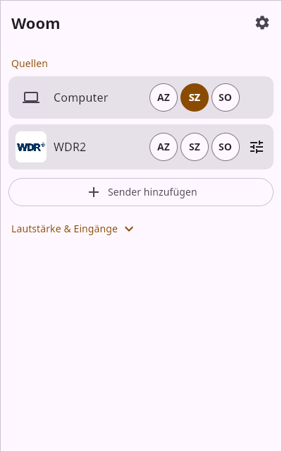

# Woom

**A simple, unofficial remote for WiiM streamers** – for Android, Linux and Windows.

Woom does one thing: start your favourite radio stations on your WiiM devices with one tap, play them in sync
on several devices, and switch volume and inputs. No account, no cloud, everything stays on your network.

> Woom is an independent open-source project. It is not affiliated with, endorsed by or supported by WiiM or Linkplay.
> "WiiM" is a trademark of its owner and is used here only to say which devices Woom works with.

## Features

- **Station bars** with one round button per device (up to 5). Tap a device to play the station;
  tap a second device to have it join and play **in sync** (multiroom group); tap a playing device to stop just that one.
- **Station search** in the free directory [radio-browser.info](https://www.radio-browser.info) – fills in name,
  stream URL and logo. Any stream URL can also be entered by hand.
- **Presets:** save a station to the device's preset buttons.
- **Volume, mute and inputs** (line-in, optical, Bluetooth, HDMI, phono, …) per device.
- **PC version as tray icon:** a small window next to the clock, no taskbar entry, starts at login (can be switched off).
- **Device audio:** plays the sound of your phone or computer over Bluetooth on one WiiM. Low delay, and video
  players compensate for it, so films stay in sync. Can be switched off in the settings.
- Devices are found automatically on the local network (or added by IP address).
- 10 languages: English, German, French, Spanish, Italian, Dutch, Polish, Portuguese, Japanese, Chinese (simplified).

Tested with WiiM Ultra, WiiM Mini and WiiM Sound. Other WiiM/Linkplay devices will probably work too.

## Download

See [Releases](../../releases):

| Platform | File | Install |
|---|---|---|
| Android 9+ | `Woom.apk` | Open the file on the phone and allow installing from this source. |
| Linux (Debian, Ubuntu, Mint, …) | `Woom-linux.deb` | `sudo apt install ./Woom-linux.deb`, then start Woom from the menu. |
| Windows 10/11 | `WoomSetup.exe` | Run the installer – installs to `%LOCALAPPDATA%\Woom` (no admin rights), with an optional "start at login". Java is included. |

Notes:
- The tray icon on Linux uses StatusNotifier (Cinnamon, KDE, XFCE, MATE; GNOME needs the AppIndicator extension).
- Windows SmartScreen warns on first start because the program is not signed.
- The Windows build runs on Windows 10/11 (start, device discovery, settings and device audio).

## Building

| Part | Folder | Command |
|---|---|---|
| Android app | `android/` | `./gradlew assembleRelease` (tests: `./gradlew testDebugUnitTest`) |
| PC, run | `desktop/` | `./gradlew run` |
| Linux package | `desktop/` | `./gradlew packageReleaseDeb` |
| Windows package (built on Linux) | `desktop/` | `WIN_JDK=<Windows JDK 21> ./build-windows.sh` – see `desktop/README.md` |
| Windows installer (built on Windows) | `desktop/` | `powershell -File build-windows.ps1` – see `desktop/README.md` |

Requirements: JDK 21, Android SDK (for the app), mingw-w64 and zip (Windows package on Linux), Inno Setup (Windows installer on Windows).

Code layout: protocol, data model and app logic live in `shared/src` and are used by both the Android app
(Kotlin + Jetpack Compose) and the PC version (Compose Multiplatform). Developer notes are in `android/README.md` and
`desktop/README.md`.

## Protocol documentation

`docs/` describes the WiiM/Linkplay network interface as far as Woom uses or has examined it: the HTTP API
(`httpapi.asp`), discovery (mDNS, SSDP), UPnP services, multiroom groups, presets and Bluetooth input.
It was worked out for interoperability and checked against real devices.

## License

[GPL-3.0](LICENSE)
